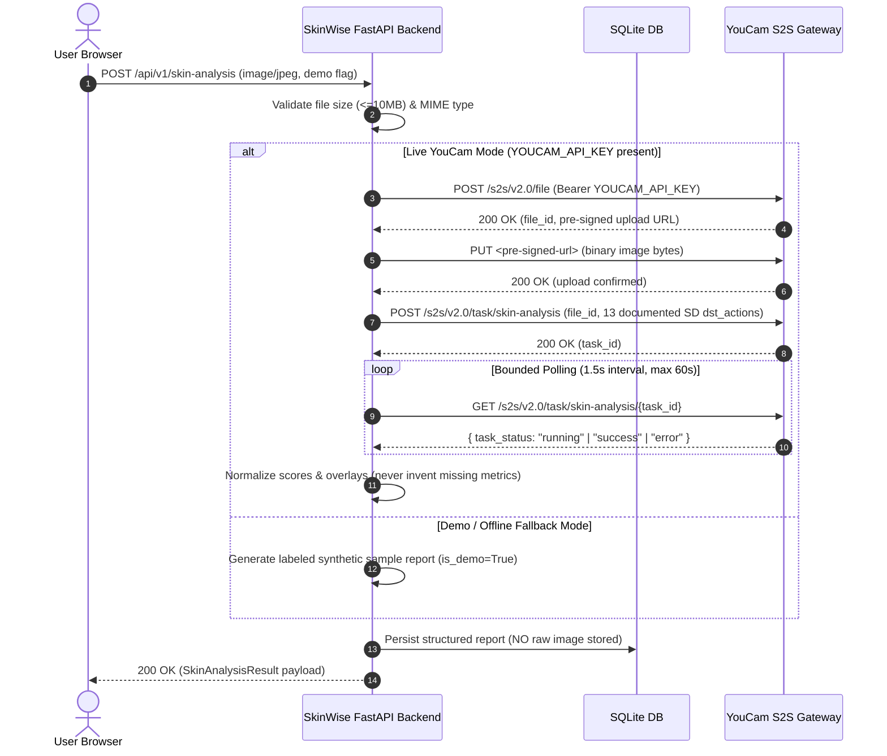

# SkinWise AI — Architecture & Integration Specification

## 1. System Overview

SkinWise AI is an explainable skincare decision assistant built for the **YouCam API Skin AI & eCommerce VTO Hackathon**. It bridges empirical facial computer vision diagnostics with deterministic routine formulation and smart skincare shopping in Indian Rupees (₹).

```
+-----------------------------------------------------------------------------------+
|                                  USER BROWSER                                     |
|  React 19 + TypeScript + Vite + Tailwind CSS + React Router + Lucide React        |
|                                                                                   |
|  [ Landing Page ] -> [ Skin Analysis ] -> [ Results Dashboard ]                   |
|                              |                    |                               |
|                              v                    v                               |
|                     [ Routine Builder ]  [ Smart Shop (₹) ]  [ Skin Journal ]     |
+------------------------------------------+----------------------------------------+
                                           | HTTP / REST (VITE_API_BASE_URL)
                                           v
+-----------------------------------------------------------------------------------+
|                              FASTAPI BACKEND (Python)                             |
|                                                                                   |
|  +--------------------+  +--------------------+  +-----------------------------+  |
|  |  Validation Layer  |  |   Database Layer   |  |     YouCam S2S Service      |  |
|  |  (MIME, 10MB limit)|  | SQLite + SQLAlchemy|  |  (Upload -> Task -> Poll)   |  |
|  +--------------------+  +--------------------+  +-----------------------------+  |
|                                                                                   |
|  +---------------------------------+  +----------------------------------------+  |
|  |    Routine Formulation Engine   |  |       Catalogue & Match Engine         |  |
|  |    (Deterministic Rule Set)     |  |       (Explainable Multi-Vector)       |  |
|  +---------------------------------+  +----------------------------------------+  |
+------------------------------------------+----------------------------------------+
                                           | Server-to-Server HTTPS
                                           v
+-----------------------------------------------------------------------------------+
|                        PERFECT CORP / YOUCAM S2S API                              |
|                                                                                   |
|  1. POST /s2s/v2.0/file                  -> Register upload slot & get pre-signed |
|  2. PUT <pre-signed-url>                 -> Direct binary image upload to S3      |
|  3. POST /s2s/v2.0/task/skin-analysis    -> Initiate AI diagnostics               |
|  4. GET /s2s/v2.0/task/skin-analysis/:id -> Bounded polling for terminal state    |
+-----------------------------------------------------------------------------------+
```

---

## 2. Server-to-Server YouCam Workflow



---

## 3. Data Privacy & Zero-Selfie Retention

1. **Ephemeral Processing**: The user's image is held in server memory only during the active analysis request.
2. **No Image Disk Storage**: Neither raw selfies nor processed photos are written to SQLite or local persistent storage.
3. **Structured Metrics Only**: Only the non-sensitive diagnostic metrics (scores, skin type, estimated skin age, timestamps) are retained in `AnalysisReportDB`.
4. **Instant Deletion**: Users have full delete controls (`DELETE /api/v1/reports/:id` and `DELETE /api/v1/journal/:id`).

---

## 4. Explainable Matching Algorithm

Unlike opaque ranking systems, SkinWise AI implements deterministic score formulation:

$$\text{Score} = \text{Baseline}(20) + \text{SkinTypeMatch}(30) + \sum \text{ConcernMatches}(15) + \text{BudgetMatch}(15) + \text{FragranceFree}(10)$$

* If any user-specified avoided ingredient is found in `all_ingredients`, the product is immediately penalized or omitted from matches.
* Every matched product carries explicit, human-readable bullet points explaining why it was recommended.
